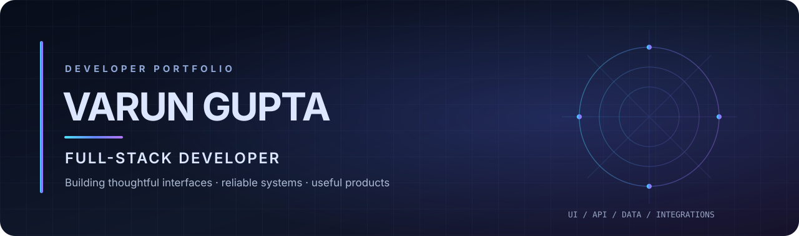

  
    
  <strong>Building useful digital products from interface to infrastructure.</strong>
   
  React · TypeScript · JavaScript · Node.js · Express · MongoDB
    
  <a href="https://blue-crab-314523.hostingersite.com">Portfolio</a>
  &nbsp;·&nbsp;
  <a href="https://strydegosox.com">Live client project</a>
  &nbsp;·&nbsp;
  <a href="https://github.com/varung4067-hash?tab=repositories">Repositories</a>
    
  
  
  

---

## Profile

I build responsive websites and full-stack applications that connect polished user experiences with practical business workflows. My projects span e-commerce, business websites, admin dashboards, payment integrations and security tooling.

I enjoy working across the complete product lifecycle: understanding the problem, shaping the interface, building APIs and data flows, integrating services, and validating critical user journeys.

**What I care about:** clear UX, maintainable code, secure-by-design workflows, and outcomes that can be explained with evidence.

## Selected work

### 01 · StrydeGoSox
**Client e-commerce platform** · <a href="https://strydegosox.com">Live website ↗</a>

An end-to-end storefront for a consumer product brand, built to connect product discovery, checkout, payment verification and order operations.

**Business challenge**  
The business needed a branded online shopping experience and a dependable workflow for accepting orders, validating payments, managing inventory and supporting fulfilment.

**Solution delivered**
- Responsive storefront with product pages, cart, checkout and order history.
- Admin dashboard for catalogue, inventory and order management.
- Node.js / Express REST API backed by MongoDB and Mongoose.
- Razorpay integration with server-side price and stock validation, payment-signature checks and signed webhook handling.
- JWT authentication, bcrypt password hashing, HTTP-only cookies, Helmet, restricted CORS and rate limiting.
- Transactional order emails through Resend and transaction-aware inventory operations.

**Reported business activity**

| Client-reported metric | Context |
|:--|:--|
| **70 orders** | Reported during the first week after launch |
| **500+ orders** | Reported during the first month |

Order counts were reported by the client. They are not a measured conversion-rate, revenue or profit uplift.

**Technology:** `HTML` `CSS` `JavaScript` `Node.js` `Express` `MongoDB` `Mongoose` `Razorpay` `Resend` `JWT`

---

### 02 · Sai Shradha Construction
**Corporate website + interactive 3D experience** · <a href="https://blue-crab-314523.hostingersite.com/#work">Portfolio preview ↗</a>

A multi-page digital presence designed to make a construction company's capabilities, services, project work and safety information easier to explore.

**Business challenge**  
Visitors needed a clear way to understand the company's services, review completed work and move naturally towards an enquiry.

**Solution delivered**
- Six content areas: Home, About, Services, Projects, Safety and Contact.
- Reusable React components, responsive navigation and mobile-first layouts.
- Project showcases, filtering and clear enquiry calls to action.
- Scroll-linked 3D construction sequence and motion-led interactions.
- Visual fallback and reduced-motion support.

**Technology:** `React 18` `Vite` `Tailwind CSS` `React Router` `Framer Motion` `GSAP` `Three.js` `React Three Fiber`

Impact: improved the organisation and presentation of business information. No verified traffic, enquiry or conversion baseline is available, so no percentage uplift is claimed. The link opens the project preview in the Varun & Co. portfolio, not a standalone construction-site URL.

---

### 03 · Varun & Co.
**Digital studio website** · <a href="https://blue-crab-314523.hostingersite.com">Visit website ↗</a>

The studio's own website, designed to explain its offering, establish trust and guide prospective clients towards a project enquiry.

**Business challenge**  
The website needed to communicate what the studio does, how projects are delivered and what a prospective client should do next.

**Solution delivered**
- Clear positioning: *We help businesses transform into brands.*
- Four service areas: Website Development, Business Software, Branding & Digital Presence, and Hosting & Support.
- Five-stage delivery process: Discovery → Strategy → Design → Development → Launch.
- Work showcase, service details, FAQ, responsive navigation and enquiry hand-off.
- Consistent visual language with motion-led interactions.

**Technology:** `React` `TypeScript` `Tailwind CSS` `Motion for React` `Lucide React` `Custom CSS`

Impact: created a structured service-discovery and enquiry experience. Lead-generation and conversion percentages are not claimed without verified analytics.

---

### 04 · VishalTechStore
**Hardware e-commerce application** · <a href="https://blue-crab-314523.hostingersite.com/#work">Portfolio preview ↗</a>

A computer-hardware shopping platform with customer-facing commerce flows and an admin workflow for managing the catalogue.

**Business challenge**  
The store needed more than static product pages: customers needed a complete shopping journey while the owner needed to maintain products, prices and inventory without editing source code.

**Solution delivered**
- Component catalogue, product browsing, cart and quantity controls.
- Checkout and order-history workflows.
- Admin dashboard to create, update and remove products and manage prices and inventory.
- MongoDB Atlas persistence and backend order workflows.
- Razorpay payment initiation with server-side signature, amount and currency verification.
- Transactional order-confirmation emails through Resend.

**Technology:** `HTML` `CSS` `JavaScript` `Node.js` `Express` `MongoDB Atlas` `Razorpay` `Resend`

Impact: brought customer shopping and owner-side catalogue management into one application. No verified sales, time-saving or conversion baseline is available. The portfolio currently displays this project as VarunTechStore; VishalTechStore is the name used in my project list. The link is a portfolio preview, not a standalone store URL.

---

### 05 · Sysmon SIEM Homelab
**Security monitoring + detection engineering** · <a href="https://github.com/varung4067-hash/soc-homelab-siem-project">Explore repository ↗</a>

A Python / Flask-based Windows endpoint-monitoring lab using Sysmon telemetry and Windows Event Logs.

**What I engineered**
- Detection rules for suspicious PowerShell activity, encoded commands and brute-force behaviour.
- Alert enrichment with severity and confidence context.
- MITRE ATT&CK mapping and basic attack-chain correlation.
- Flask dashboard for alert review and security-event visualisation.

**Technology:** `Python` `Flask` `Sysmon` `Windows Event Logs` `PowerShell` `MITRE ATT&CK`

**Project-reported engineering result:** approximately **30–40% less false-positive noise** after detection-rule tuning in project testing. This is not an independently audited benchmark.

---

## Impact, with context

  <table>
    <tr>
      <td align="center" width="33%">
        <h2>70</h2>
        <strong>First-week orders</strong> 
        Client-reported · StrydeGoSox
      </td>
      <td align="center" width="33%">
        <h2>500+</h2>
        <strong>First-month orders</strong> 
        Client-reported · StrydeGoSox
      </td>
      <td align="center" width="33%">
        <h2>30–40%</h2>
        <strong>Lower false-positive noise</strong> 
        Project testing · SIEM lab
      </td>
    </tr>
  </table>

These figures describe different outcomes. The e-commerce figures are order counts shared by the client; the SIEM figure is a project-testing estimate. None should be interpreted as conversion-rate, revenue or profit growth.

## Technical toolkit

| Area | Technologies |
|:--|:--|
| **Frontend** | React, JavaScript, TypeScript, HTML5, CSS3, Tailwind CSS |
| **Backend** | Node.js, Express, REST APIs, Python, Flask |
| **Data** | MongoDB, MongoDB Atlas, Mongoose |
| **Integrations** | Razorpay, Resend |
| **Security** | JWT, bcrypt, HTTP-only cookies, Helmet, CORS, rate limiting |
| **Motion & 3D** | Framer Motion, GSAP, Three.js, React Three Fiber |
| **Security operations** | Sysmon, Windows Event Logs, PowerShell, MITRE ATT&CK |
| **Workflow** | Git, GitHub, debugging, testing and deployment workflows |

## How I approach a build

1. **Discover** — understand the business objective and the people using the product.
2. **Design** — map the user journey, interface and application structure.
3. **Develop** — build the frontend, backend, data model and integrations.
4. **Validate** — test critical flows, edge cases, error states and security-sensitive operations.
5. **Deliver** — document what is implemented and separate verified outcomes from assumptions.

## Currently interested in

Junior **Full-Stack Developer**, **Frontend Developer** and **Node.js Developer** opportunities, plus practical product work where software can improve a real business workflow.

   
  
  
  
    
  Curious by default. Practical by design. Always improving.

