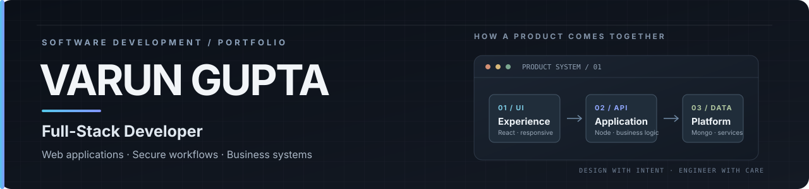
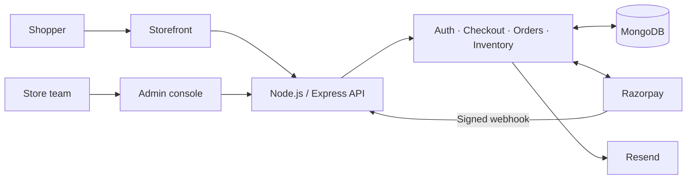

  
  
<strong>Full-Stack Developer</strong>

  
Building web products that connect thoughtful interfaces with dependable backend workflows.

  

    <a href="https://blue-crab-314523.hostingersite.com">Portfolio</a>
    &nbsp;·&nbsp;
    <a href="https://strydegosox.com">Live client project</a>
    &nbsp;·&nbsp;
    <a href="https://github.com/varung4067-hash?tab=repositories">GitHub repositories</a>
  

  Mumbai, India · Open to Full-Stack, Frontend and Node.js Developer opportunities

---

## About

I enjoy building the parts of a product that need to work together: responsive user experiences, APIs, data models, authentication and third-party integrations. I’m particularly interested in the details behind a reliable application—payment verification, inventory consistency, useful admin tools and clear failure handling.

I work across **React, JavaScript, TypeScript, Node.js, Express and MongoDB**, and continue to strengthen my engineering fundamentals through hands-on projects.

## Featured project

### StrydeGoSox — E-commerce platform

A live client storefront built around a complete commerce workflow—from product discovery and checkout to payment reconciliation and order fulfilment.

**What I worked on**
- Responsive storefront, product selection, cart and checkout experience.
- Node.js / Express APIs with server-side pricing and checkout idempotency.
- Razorpay payment verification and signed webhook processing.
- Inventory reservation, Cash on Delivery, order management and refund workflows.
- Admin dashboard and transactional email integration.

**How the product fits together**

**Client-reported activity:** 70 orders in the first week and 500+ in the first month after launch.

Order counts were shared by the client; they are not independently audited revenue or conversion metrics.

[Live store](https://strydegosox.com) · [Source repository](https://github.com/varung4067-hash/strydegosox-ecommerce) · [Architecture notes](https://github.com/varung4067-hash/strydegosox-ecommerce/blob/main/docs/ARCHITECTURE.md)

## Other work

**SIEM detection homelab**  
A Python and Flask security-monitoring project that processes Sysmon and Windows Event Logs, evaluates detection rules, maps activity to MITRE ATT&CK and presents alerts for investigation.  
[View repository](https://github.com/varung4067-hash/soc-homelab-siem-project)

**Business websites and commerce tools**  
Responsive React websites and a hardware-store application covering product catalogues, cart and checkout flows, admin-side product management and payment integration.  
[View portfolio](https://blue-crab-314523.hostingersite.com)

## Technical toolkit

| Area | Tools |
|:--|:--|
| **Frontend** | React, JavaScript, TypeScript, HTML, CSS, Tailwind CSS |
| **Backend** | Node.js, Express, REST APIs, Python, Flask |
| **Data** | MongoDB, MongoDB Atlas, Mongoose |
| **Integrations** | Razorpay, Resend |
| **Security** | JWT, bcrypt, HTTP-only cookies, Helmet, CORS, rate limiting |
| **Tools** | Git, GitHub, Linux, debugging and testing |

## How I approach development

**Understand the problem → map the workflow → build the interface and logic → test edge cases → improve.**

I value readable code, practical documentation and clear evidence over inflated claims. I’m looking for a team where I can contribute to real products, learn from experienced engineers and keep growing as a full-stack developer.

---

  <a href="https://blue-crab-314523.hostingersite.com">Portfolio</a>
  &nbsp;·&nbsp;
  <a href="https://github.com/varung4067-hash?tab=repositories">Explore my repositories</a>

