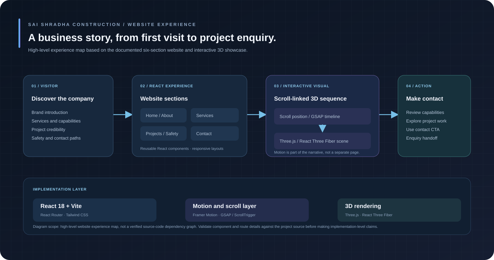
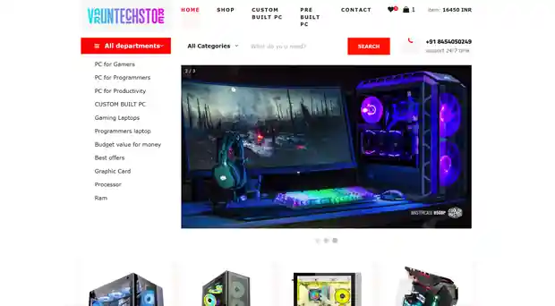
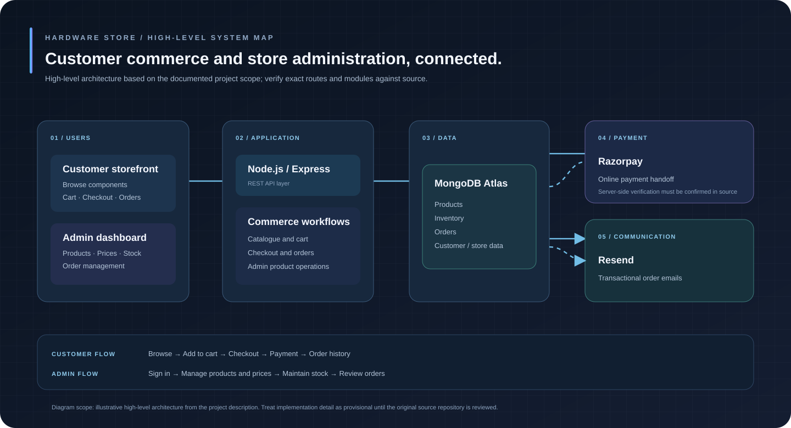
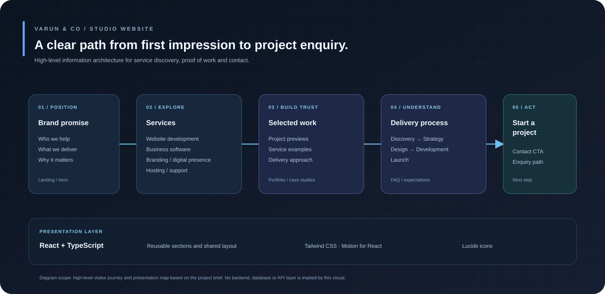

  
  <h1>Varun Gupta</h1>
  <h3>Junior Full-Stack Developer · React · Node.js · MongoDB</h3>
  
Mumbai, India · Open to Junior Full-Stack, React and Node.js opportunities

  
Building real-world web experiences with responsive interfaces, dependable application workflows and thoughtful engineering.

  

    
    
    
  

---

## About

I'm a Mumbai-based full-stack developer and BSc IT graduate interested in building useful digital products from the user interface through backend workflows and data. My practical work includes a live client e-commerce platform, business websites, product discovery experiences and a Python-based Windows telemetry lab.

I enjoy connecting the pieces that make an application useful in the real world: responsive interfaces, API contracts, database-backed workflows, authentication, payment integrations, inventory and operational dashboards. I pay particular attention to what happens beyond the happy path — invalid input, stale prices, duplicate requests, failed payments, webhook retries and permission boundaries.

I use AI-assisted development tools as part of my workflow, while focusing on understanding the implementation, integrating components, debugging issues and validating the behaviour of the finished application.

**Currently seeking:** Junior Full-Stack Developer, React Developer and Node.js Developer opportunities in Mumbai.

### How I approach application architecture

I think about a product as a set of connected responsibilities rather than isolated screens. The diagram below uses the StrydeGoSox client application to show how the browser experiences, backend business logic, persisted data and external services interact.

  

Project-specific architecture · Select the diagram for detailed runtime, checkout, inventory and trust-boundary notes.

| Application layer | Responsibility | Technologies |
|:--|:--|:--|
| Experience | Customer-facing pages and admin workflows | HTML, CSS, JavaScript |
| Application | Routing, business rules, authentication, checkout and order operations | Node.js, Express.js |
| Data | Users, products, orders, inventory and event records | MongoDB, Mongoose |
| Integrations | Payment processing and customer communication | Razorpay, Resend |
| Trust boundaries | Server-side validation, verified payment events, access control and idempotent workflows | Backend middleware and application services |

---

# Featured projects

## 01 · StrydeGoSox — Live client e-commerce platform

Full-stack development · Payments · Inventory · Order operations · Client delivery

  

**Overview**

StrydeGoSox is a live e-commerce platform developed for a consumer product brand. It connects product discovery and product options with cart, checkout, online payments, Cash on Delivery, fulfilment and the administrative workflows needed to operate the store.

**My contribution and engineering work**
- Built and integrated the responsive storefront, product-detail experience, product options, cart and checkout journey.
- Developed backend API workflows with Node.js and Express.js, using MongoDB and Mongoose for application data.
- Implemented server-side cart repricing so the backend calculates order totals using trusted catalogue records rather than accepting browser-submitted prices.
- Integrated Razorpay order creation and server-side payment-signature verification.
- Implemented signed webhook handling and event tracking to reconcile payment events and reduce duplicate side effects.
- Added checkout idempotency so retried submissions can be handled as one intended checkout operation.
- Worked on inventory reservation, commit, release and restoration as orders and payments change state.
- Built authenticated admin workflows for catalogue and stock management, order processing, fulfilment, COD collection and remittance, and refunds.
- Integrated transactional order and status emails through Resend.

**Application architecture**

  

| Layer | Implementation |
|:--|:--|
| Customer experience | Storefront for catalogue browsing, product options, cart and checkout |
| Admin experience | Protected dashboard for products, inventory, orders, fulfilment, COD and refunds |
| API and business logic | Express routes and shared order, inventory, payment and email helpers |
| Persistence | MongoDB models for users, products, orders, webhook events and store settings |
| External services | Razorpay payment services and Resend transactional email |

**Security and reliability measures documented in the project**
- **Trusted pricing:** the backend recalculates order totals from database catalogue records.
- **Payment verification:** payment signatures and expected transaction values are checked server-side.
- **Webhook integrity:** signed callbacks are validated and event records help prevent repeated processing.
- **Idempotency:** checkout requests use an idempotency key to reduce duplicate order creation on retries.
- **Inventory consistency:** stock is reserved, committed, released or restored through explicit order-state transitions.
- **Admin access control:** protected routes use authentication and role checks; session tokens are carried in HTTP-only cookies.
- **Application hardening:** the project documents Helmet, Content Security Policy, CORS controls, rate limits and request IDs.
- **Secret handling:** database and provider credentials are kept in private environment configuration; .env is excluded from the public-ready package.

**Validation evidence:** the latest dependency-security commit in the project reports npm ci, npm run check, npm run qa with 44/44 checks, and npm audit with zero vulnerabilities in GitHub Actions. This is evidence for that recorded run, not a guarantee that every future deployment is secure.

**Client-reported activity:** the client reported 70 orders in the first week and 500+ orders in the first month after launch. These are client-reported order counts, not independently audited revenue or conversion figures.

**Technology used**

HTML5 · CSS3 · JavaScript · Node.js · Express.js · MongoDB · Mongoose · Razorpay · Resend · JWT · bcryptjs · Helmet

**Explore the project**

[Live store](https://strydegosox.com) · [Source code](https://github.com/varung4067-hash/strydegosox-ecommerce) · [Architecture and checkout sequence](https://github.com/varung4067-hash/strydegosox-ecommerce/blob/main/docs/ARCHITECTURE.md) · [Security notes](https://github.com/varung4067-hash/strydegosox-ecommerce/blob/main/SECURITY.md)

Additional real product screens: [Product details](https://github.com/varung4067-hash/strydegosox-ecommerce/blob/main/docs/screenshots/02-product-specifications.jpg) · [Bundle options](https://github.com/varung4067-hash/strydegosox-ecommerce/blob/main/docs/screenshots/03-bundle-options.jpg)

---

## 02 · Sai Shradha Construction — Construction company website

React frontend · Responsive corporate website · Project showcase · Scroll-linked 3D experience

  

**Overview**

A corporate website experience for a construction business, designed to present the company, explain its services and make its project portfolio easier to explore. The information architecture follows six primary sections: Home, About, Services, Projects, Safety and Contact.

The visual direction pairs a construction-project hero with a clear navigation system, a prominent enquiry action and a structured company-information layout. The project is intended to communicate credibility, capabilities and a clear path for prospective clients to get in touch.

**My contribution and frontend engineering**
- Structured the website around the visitor journey: company introduction → services → projects → safety information → contact.
- Built reusable React components and responsive page layouts for desktop and smaller screens.
- Organised service and project content into clear, scannable sections.
- Created project showcase and enquiry call-to-action areas to connect visitors with the business.
- Developed a scroll-linked 3D construction sequence using GSAP / ScrollTrigger and Three.js with React Three Fiber.
- Used Framer Motion for interface transitions and interaction details.
- Considered responsive behaviour and reduced-motion fallbacks so visual effects do not become the only way to understand the content.

**Website experience architecture**

  

Experience architecture: this diagram maps the visitor journey and frontend presentation layers; it is not a backend or database dependency diagram.

| Frontend area | Technology | Purpose |
|:--|:--|:--|
| Page and component structure | React 18 | Reusable sections and UI composition |
| Development and build | Vite | Frontend development and production bundling |
| Styling and responsiveness | Tailwind CSS | Layout, spacing and responsive design |
| Navigation | React Router | Page/section navigation structure |
| UI motion | Framer Motion | Interface transitions and interaction feedback |
| Scroll choreography | GSAP / ScrollTrigger | Scroll-linked animation timeline |
| 3D presentation | Three.js / React Three Fiber | Interactive construction visualisation |

**Security scope**

This is documented as a public-facing corporate website experience. The available project material does not establish user accounts, payment processing or a private application API, so I do not claim authentication or payment-security controls for it. The security boundary for this type of site is to keep private credentials out of client-side bundles, serve the site over HTTPS, minimise third-party scripts, and validate and rate-limit any server-side contact/enquiry endpoint. These are production safeguards to verify against the deployed implementation rather than claims of a separate backend security system.

**Technology used**

React 18 · Vite · Tailwind CSS · React Router · Framer Motion · GSAP · ScrollTrigger · Three.js · React Three Fiber

**Project visual:** the screenshot above is an actual supplied project screenshot, not generated concept artwork.

---

## 03 · VarunTechStore — PC components and custom-build store

Hardware e-commerce · Component catalogue · Custom and pre-built PC discovery · Store workflows

  

**Overview**

VarunTechStore is a hardware and PC-components store experience focused on helping customers discover computer parts, gaming systems and custom or pre-built PC options. Its catalogue navigation is organised around customer needs as well as hardware categories — including PCs for gaming, programming and productivity, gaming laptops, custom builds, graphics cards, processors and RAM.

The main experience combines store navigation, department/category discovery, search and promotional product presentation. The wider application scope includes shopping-cart and checkout workflows, order history and product/inventory management.

**My contribution and application scope**
- Designed the store structure around departments, component categories and PC-use-case collections.
- Organised product discovery for graphics cards, processors, memory, PC cases, motherboards and complete PC builds.
- Worked on customer shopping workflows including product browsing, add-to-cart, checkout and order history.
- Included administrative product and pricing management so catalogue changes do not require editing page markup.
- Used MongoDB Atlas as the data store for product and inventory records.
- Integrated the store workflow with Razorpay for online payments and Resend for transactional email.

**High-level commerce architecture**

  

High-level architecture based on the documented project scope. Exact routes, schema details and provider callback handling should be checked against the implementation before treating them as verified internals.

| Layer | Responsibility | Technology / service |
|:--|:--|:--|
| Storefront | Navigation, categories, product discovery and shopping journey | HTML, CSS, JavaScript |
| Application | Product, cart, checkout and admin workflows | Node.js, Express.js |
| Data | Product catalogue and inventory records | MongoDB Atlas |
| Payments | Online payment handoff | Razorpay |
| Email | Order and customer notifications | Resend |

**Security and trust boundaries**

For an e-commerce system, the critical security boundaries are server-side price and stock validation, authenticated and role-restricted admin operations, safe handling of customer information, and payment confirmation performed by the backend rather than inferred from a browser redirect. Razorpay secrets and email credentials must remain in server-side environment variables; payment signatures and webhooks should be validated server-side and retry handling should avoid duplicate order side effects.

The available portfolio material describes the integrations and workflows but does not include a separate public source repository or test evidence for every control above. I therefore present these as the security boundaries and production checks for this project, not as independently verified implementation claims.

**Technology used**

HTML · CSS · JavaScript · Node.js · Express.js · MongoDB Atlas · Razorpay · Resend

**Project visual:** the screenshot above is the actual supplied VarunTechStore page, not a generated website mockup.

---

## 04 · Varun & Co. — Digital studio website

Studio website · Service positioning · Selected work · Project enquiry journey

**Overview**

Varun & Co. is a digital studio website built to communicate the studio's services, present selected work and guide prospective clients towards starting a project. Its positioning focuses on helping businesses turn into brands through useful digital experiences.

**What the website includes**
- Service categories covering Website Development, Business Software, Branding & Digital Presence, and Hosting & Support.
- A five-stage delivery narrative: Discovery → Strategy → Design → Development → Launch.
- Selected work, service details, FAQs and project-enquiry calls to action.
- Responsive navigation, reusable interface sections and motion-led interactions intended to support the content rather than distract from it.

**Website information architecture**

  

Website information architecture and visitor journey; no backend, database or authentication layer is implied by this diagram.

**Technology used**

React · TypeScript · Tailwind CSS · Motion for React · Lucide React · Custom CSS

**Security scope**

The available project description documents a studio/marketing website and does not establish account or payment functionality. The appropriate security focus is to avoid placing secrets in client-side code, use HTTPS, keep dependencies maintained, and validate and protect any project-enquiry endpoint on the server if one is connected. I do not claim a private backend or authentication system without source-level evidence.

[Visit Varun & Co.](https://blue-crab-314523.hostingersite.com) · [Explore selected work](https://blue-crab-314523.hostingersite.com/#work)

---

## 05 · Sysmon SIEM Homelab — Endpoint telemetry and detection engineering

Python · Windows Sysmon · PowerShell detection · Alert enrichment · Flask dashboard

**Overview**

A Windows endpoint-monitoring learning lab exploring how Sysmon process-creation telemetry can be converted into structured alerts for investigation. The current pipeline reads Sysmon Event ID 1 from the Microsoft-Windows-Sysmon/Operational channel, examines process command lines for suspicious PowerShell indicators and presents alert context in a Flask dashboard.

  

**Detection pipeline architecture**

  

**What I implemented and explored**
- **Telemetry collection:** reads Windows Sysmon process-creation events (Event ID 1).
- **Event parsing:** uses Python, Windows event APIs and XML parsing to extract process context.
- **PowerShell triage rules:** looks for indicators including encoded PowerShell (-enc), FromBase64String, Invoke-Expression / IEX, and DownloadString.
- **Alert enrichment:** attaches severity, a confidence value, a detection rationale and MITRE ATT&CK technique T1059.001.
- **Noise reduction:** deduplicates matching command lines in the Sysmon agent.
- **Basic correlation:** groups alerts that share a host and user within a ten-minute window.
- **Investigation interface:** a Flask dashboard presents alert details, severity summaries and visualisations.

**Security interpretation and limitations**

This is a learning and experimentation project, not a production SIEM or endpoint security product. Its keyword-based detections are triage signals, not proof of compromise; legitimate administration can use some of the same commands and the surrounding process context must be investigated.

The repository also documents engineering work still required before a reproducible deployment: reconciling the Python package/import layout, adding a dependency manifest, aligning the Flask template and static-file paths, separating example chart/sample alert data from live telemetry, and adding automated rule tests and measured false-positive evaluation. These limitations are kept visible so the project is presented accurately.

**Technology used**

Python · Sysmon · Windows Event Logs · pywin32 · XML Parsing · Flask · HTML · CSS · Chart.js · MITRE ATT&CK

[Source code and project documentation](https://github.com/varung4067-hash/soc-homelab-siem-project) · [Detection architecture](https://github.com/varung4067-hash/soc-homelab-siem-project/blob/main/docs/architecture.svg) · [Alert screenshot](https://github.com/varung4067-hash/soc-homelab-siem-project/blob/main/ALERTS.png)

---

## Technical toolkit

| Area | Technologies and tools |
|:--|:--|
| Frontend | JavaScript, React, TypeScript, HTML5, CSS3, Tailwind CSS, responsive UI |
| Backend | Node.js, Express.js, REST APIs, Python, Flask |
| Databases | MongoDB, MongoDB Atlas, Mongoose |
| Payments and integrations | Razorpay, Resend, payment callbacks and webhooks |
| Application security | JWT, bcryptjs, HTTP-only cookies, Helmet, CSP, CORS, rate limiting, server-side validation |
| Security operations | Sysmon, Windows Event Logs, PowerShell, MITRE ATT&CK, alert triage |
| Motion and 3D | Framer Motion, GSAP, ScrollTrigger, Three.js, React Three Fiber |
| Development workflow | Git, GitHub, debugging, documentation, QA and deployment workflows |

## Education and professional background

**Bachelor of Science in Information Technology (BSc IT)**  
Guru Nanak Khalsa College · University of Mumbai · 2025

**Customer Support Executive — Teleperformance**  
Worked on an international Airbnb support process for six months, handling 1,000+ customer interactions. This experience strengthened my communication, troubleshooting, customer empathy and issue-resolution skills.

## Learning and certifications

- Google Cybersecurity Professional Certificate — completed.
- TryHackMe SOC Level 1 learning path — completed.
- CompTIA Security+ — currently preparing.

## What I bring to a team

- An end-to-end perspective on customer journeys, APIs, data and third-party integrations.
- Experience developing and launching a client-facing e-commerce application.
- Curiosity about application security, endpoint telemetry and system behaviour.
- Clear communication, practical debugging habits and willingness to learn through feedback.

  <h3>Let's build something useful.</h3>
  

    <a href="https://blue-crab-314523.hostingersite.com">Portfolio</a>
    &nbsp;·&nbsp;
    <a href="https://github.com/varung4067-hash?tab=repositories">GitHub repositories</a>
    &nbsp;·&nbsp;
    <a href="https://strydegosox.com">Live client project</a>
  

  Thoughtful interfaces · Reliable workflows · Continuous improvement

