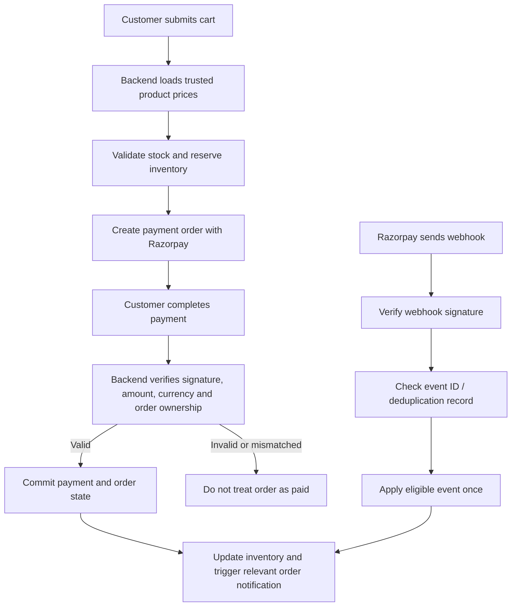
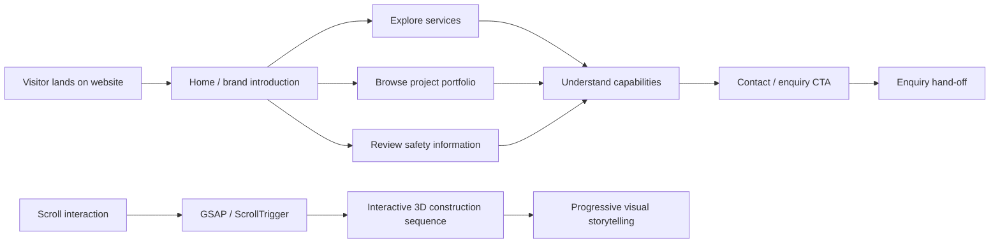
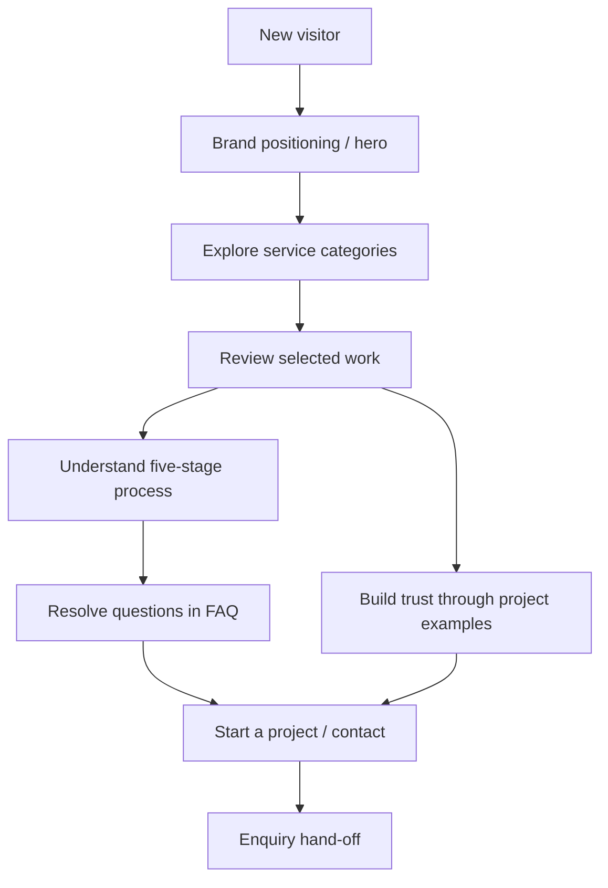
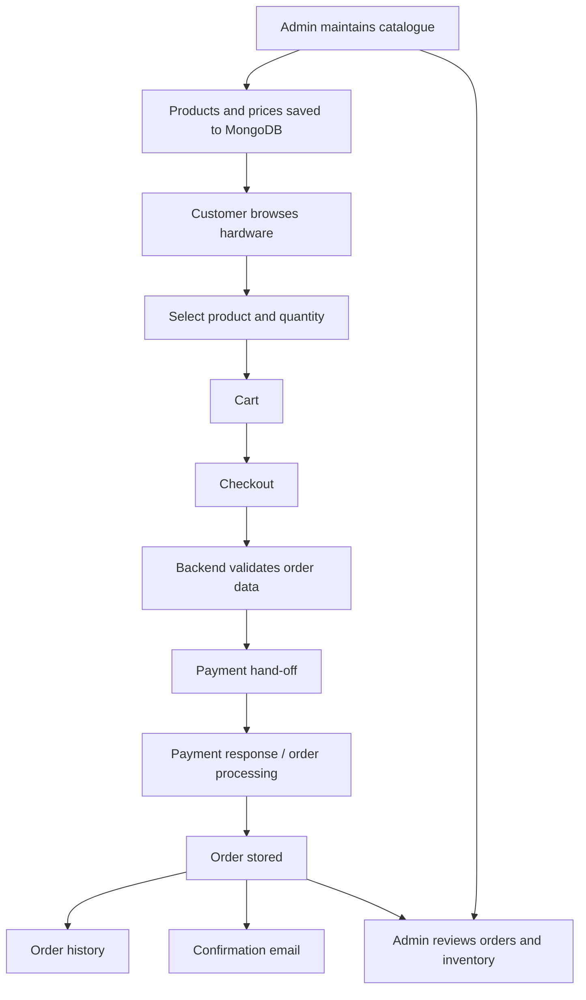
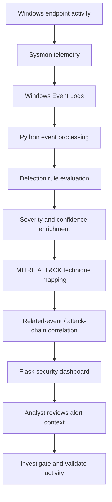

  

  
<strong>Building useful digital products from interface to infrastructure.</strong> 
  React · TypeScript · Node.js · Express · MongoDB · Razorpay

  

    <a href="https://blue-crab-314523.hostingersite.com">Portfolio</a>
    &nbsp;·&nbsp;
    <a href="https://strydegosox.com">Live client project</a>
    &nbsp;·&nbsp;
    <a href="https://github.com/varung4067-hash?tab=repositories">Repositories</a>
  

  
  
  

## Profile

I’m a full-stack developer who enjoys working where **product experience meets engineering reliability**. I like taking a real problem—an awkward customer journey, a manual business process or a fragile checkout flow—and turning it into a working application with a clear interface and dependable logic behind it.

My work covers the parts of a product that need to fit together: responsive frontend experiences, backend APIs, database models, authentication, third-party integrations and the operational tools people use after launch. I’m especially interested in the details that are easy to overlook but matter in real use: what happens when a payment is delayed, a customer clicks twice, stock changes during checkout, an API request fails or an admin action needs to be protected.

Recent work gives a flavour of that range:
- **E-commerce engineering:** built a client store with Razorpay payment verification, webhook validation, duplicate-checkout safeguards, inventory reservation and admin order workflows.
- **Interactive web experiences:** developed multi-page business websites with responsive React interfaces, motion design, project showcases and a scroll-linked 3D experience.
- **Security engineering:** created a Python / Flask SIEM homelab that processes Sysmon and Windows Event Logs, enriches detections and maps activity to MITRE ATT&CK.

### What I bring to a project

| Focus | How I approach it |
|:--|:--|
| **Product thinking** | Start with the user journey and the business problem, not just the page or feature request. |
| **End-to-end development** | Connect the interface, API, database and external services into one coherent workflow. |
| **Security-minded engineering** | Keep sensitive decisions on the backend, validate inputs and payments, protect admin routes and handle retries carefully. |
| **Interface craft** | Build responsive layouts with clear hierarchy, purposeful interactions and motion that supports the experience. |
| **Practical problem-solving** | Debug across the stack, test failure paths and improve the parts that affect real users and operators. |
| **Continuous learning** | Strengthen fundamentals while exploring better patterns, tools and ways to build maintainable software. |

### How I like to work

**Understand → Design → Build → Validate → Improve**

I break a requirement into the complete user flow, identify the data and integrations it depends on, build the smallest coherent solution, and test both the happy path and the failure cases. I value readable implementation, honest documentation and measurable outcomes over inflated claims.

**Currently interested in:** junior Full-Stack Developer, Frontend Developer and Node.js Developer opportunities, and teams where I can contribute to real products while continuing to grow as an engineer.
## Selected work

### 01 · StrydeGoSox
**Client e-commerce platform · Transaction security & order-integrity engineering** · <a href="https://strydegosox.com">Live website ↗</a> · <a href="https://github.com/varung4067-hash/strydegosox-ecommerce">GitHub repository ↗</a>

  

An end-to-end storefront for a consumer product brand, built to connect product discovery, checkout, payment verification, inventory operations and order fulfilment. A major part of the work was making the order lifecycle dependable—not simply making checkout look successful in the browser.

**Business challenge**  
An e-commerce checkout must handle more than successful purchases. It also needs to cope with altered browser data, forged payment confirmations, repeated clicks, gateway webhook retries, concurrent stock requests and refund edge cases. Without server-side controls, these situations can create false paid states, duplicate records or inconsistent inventory.

**Transaction security & abuse-resistance controls**

| Risk scenario | Safeguard implemented | Practical business value |
|:--|:--|:--|
| **Price tampering** | The backend rebuilds checkout pricing from trusted product records instead of trusting browser-submitted totals. | Helps prevent altered cart prices from becoming the amount charged or recorded for an order. |
| **Fake payment-success response** | Server-side Razorpay checkout-signature verification, with checks for expected payment details, amount, currency and Razorpay order ownership. | The browser's success screen alone is not enough to mark an online order as paid; invalid or mismatched payment data should fail verification. |
| **Forged payment webhook** | Razorpay webhook signature verification using the raw request body and configured webhook secret. | Helps reject spoofed payment-event notifications before the application processes them. |
| **Repeated webhook delivery** | Processed-event tracking using the Razorpay event ID where available, deterministic SHA-256 fallback and unique database protection. | Makes gateway retries and duplicate event delivery less likely to trigger the same order/inventory side effect more than once. |
| **Double-click / checkout retry** | Checkout idempotency using an `Idempotency-Key`. | Repeated submissions of the same checkout operation are handled as one intended request, reducing accidental duplicate order creation from impatient clicks, network retries or browser resubmissions. |
| **Overselling / stock mismatch** | Server-side stock validation and transaction-aware inventory reservations: reserve while payment is pending, commit after successful capture, release on relevant failure/expiry paths and restore stock through refund workflows. | Helps protect stock availability during concurrent checkouts and reduces inventory drift when payments fail, expire or are refunded. |
| **Repeated / competing refund actions** | Refund workflow includes concurrency protection, payment reconciliation and inventory restoration. | Helps prevent conflicting refund operations and keeps the order/payment/stock records aligned. |
| **Admin endpoint abuse** | JWT-based admin authentication, role enforcement, bcrypt password hashing, HTTP-only secure session cookies, Helmet security headers and CSP, restricted CORS, rate limiting, request/input validation and no-store controls on sensitive APIs. | Protects privileged catalogue, inventory and order operations and reduces exposure to common request-abuse patterns. |
| **Duplicate customer notifications** | Transactional email is triggered from backend order events; supported notification operations use idempotency safeguards. | Reduces repeat confirmation/status emails when a supported operation is retried. |

**How the protected online-payment flow works**

**What this changes for the business**
- Makes online order confirmation depend on backend-verified payment data, not a customer-controlled browser response.
- Reduces accidental duplicate order creation from repeated submissions of the same checkout request.
- Reduces repeat processing when Razorpay retries or redelivers the same webhook event.
- Helps prevent stock overselling and mismatches across pending payments, successful captures, failures, expiries and refunds.
- Makes admin and order-management actions harder to invoke without the appropriate authenticated role.

**Business activity reported by the client**

| Client-reported metric | Context |
|:--|:--|
| **70 orders** | Reported during the first week after launch |
| **500+ orders** | Reported during the first month |

These are client-reported order counts, not a measured conversion-rate, revenue or profit uplift.

**Security impact**

Layered server-side controls strengthen checkout integrity by reducing opportunities for price tampering, forged payment confirmations, duplicate order creation and replayed webhook events. Payment-aware inventory and refund handling also help keep order, payment and stock records consistent.

The result is a more resilient checkout and order-management workflow: repeated checkout attempts are guarded by idempotency, online orders are confirmed only after backend verification, and gateway events are authenticated and deduplicated.

These are documented application safeguards and risk-reduction outcomes, not a measured percentage of fraudulent orders prevented. Actual prevention rates would require production telemetry showing attempted and rejected events.

**Technology:** `HTML` `CSS` `JavaScript` `Node.js` `Express` `MongoDB` `Mongoose` `Razorpay` `Resend` `JWT` `bcryptjs` `Helmet` `CORS` `express-rate-limit`

Security scope note: these are application-level controls documented in the supplied project review. They are not a penetration-test certification or a guarantee against all fraud. Live effectiveness also depends on production secrets, gateway/database configuration, access policies, monitoring and end-to-end operational testing.

---

### 02 · Sai Shradha Construction
**Corporate website + interactive 3D experience** · <a href="https://blue-crab-314523.hostingersite.com/#work">Portfolio preview ↗</a>

A multi-page digital presence designed to make a construction company's capabilities, services, project work and safety information easier to explore.

**Business challenge**  
Visitors needed a clear way to understand the company's services, review completed work and move naturally towards an enquiry.

**Solution delivered**
- Six content areas: Home, About, Services, Projects, Safety and Contact.
- Reusable React components, responsive navigation and mobile-first layouts.
- Project showcases, filtering and clear enquiry calls to action.
- Scroll-linked 3D construction sequence and motion-led interactions.
- Visual fallback and reduced-motion support.

**Technology:** `React 18` `Vite` `Tailwind CSS` `React Router` `Framer Motion` `GSAP` `Three.js` `React Three Fiber`

**Experience workflow**

Impact: improved the organisation and presentation of business information. No verified traffic, enquiry or conversion baseline is available, so no percentage uplift is claimed. The link opens the project preview in the Varun & Co. portfolio, not a standalone construction-site URL.

---

### 03 · Varun & Co.
**Digital studio website** · <a href="https://blue-crab-314523.hostingersite.com">Visit website ↗</a>

The studio's own website, designed to explain its offering, establish trust and guide prospective clients towards a project enquiry.

**Business challenge**  
The website needed to communicate what the studio does, how projects are delivered and what a prospective client should do next.

**Solution delivered**
- Clear positioning: *We help businesses transform into brands.*
- Four service areas: Website Development, Business Software, Branding & Digital Presence, and Hosting & Support.
- Five-stage delivery process: Discovery → Strategy → Design → Development → Launch.
- Work showcase, service details, FAQ, responsive navigation and enquiry hand-off.
- Consistent visual language with motion-led interactions.

**Technology:** `React` `TypeScript` `Tailwind CSS` `Motion for React` `Lucide React` `Custom CSS`

**Visitor-to-enquiry workflow**

Impact: created a structured service-discovery and enquiry experience. Lead-generation and conversion percentages are not claimed without verified analytics.

---

### 04 · VishalTechStore
**Hardware e-commerce application** · <a href="https://blue-crab-314523.hostingersite.com/#work">Portfolio preview ↗</a>

A computer-hardware shopping platform with customer-facing commerce flows and an admin workflow for managing the catalogue.

**Business challenge**  
The store needed more than static product pages: customers needed a complete shopping journey while the owner needed to maintain products, prices and inventory without editing source code.

**Solution delivered**
- Component catalogue, product browsing, cart and quantity controls.
- Checkout and order-history workflows.
- Admin dashboard to create, update and remove products and manage prices and inventory.
- MongoDB Atlas persistence and backend order workflows.
- Razorpay payment initiation with server-side signature, amount and currency verification.
- Transactional order-confirmation emails through Resend.

**Technology:** `HTML` `CSS` `JavaScript` `Node.js` `Express` `MongoDB Atlas` `Razorpay` `Resend`

**Commerce workflow**

Impact: brought customer shopping and owner-side catalogue management into one application. No verified sales, time-saving or conversion baseline is available. The portfolio currently displays this project as VarunTechStore; VishalTechStore is the name used in my project list. The link is a portfolio preview, not a standalone store URL.

---

### 05 · Sysmon SIEM Homelab
**Security monitoring + detection engineering** · <a href="https://github.com/varung4067-hash/soc-homelab-siem-project">Explore repository ↗</a>

A Python / Flask-based Windows endpoint-monitoring lab using Sysmon telemetry and Windows Event Logs.

**What I engineered**
- Detection rules for suspicious PowerShell activity, encoded commands and brute-force behaviour.
- Alert enrichment with severity and confidence context.
- MITRE ATT&CK mapping and basic attack-chain correlation.
- Flask dashboard for alert review and security-event visualisation.

**Technology:** `Python` `Flask` `Sysmon` `Windows Event Logs` `PowerShell` `MITRE ATT&CK`

**Detection and investigation workflow**

**Project-reported engineering result:** approximately **30–40% less false-positive noise** after detection-rule tuning in project testing. This result belongs to the SIEM lab and is separate from the StrydeGoSox e-commerce security controls.

---

## Impact, with context

  <table>
    <tr>
      <td align="center" width="33%">
        <h2>70</h2>
        <strong>First-week orders</strong> 
        Client-reported · StrydeGoSox
      </td>
      <td align="center" width="33%">
        <h2>500+</h2>
        <strong>First-month orders</strong> 
        Client-reported · StrydeGoSox
      </td>
      <td align="center" width="33%">
        <h2>30–40%</h2>
        <strong>Lower false-positive noise</strong> 
        Project testing · SIEM lab
      </td>
    </tr>
  </table>

These figures describe different outcomes. The e-commerce figures are order counts shared by the client; the SIEM figure is a project-testing estimate. None should be interpreted as conversion-rate, revenue or profit growth.

## Technical toolkit

| Area | Technologies |
|:--|:--|
| **Frontend** | React, JavaScript, TypeScript, HTML5, CSS3, Tailwind CSS |
| **Backend** | Node.js, Express, REST APIs, Python, Flask |
| **Data** | MongoDB, MongoDB Atlas, Mongoose |
| **Integrations** | Razorpay, Resend |
| **Security** | JWT, bcrypt, HTTP-only cookies, Helmet, CORS, rate limiting |
| **Motion & 3D** | Framer Motion, GSAP, Three.js, React Three Fiber |
| **Security operations** | Sysmon, Windows Event Logs, PowerShell, MITRE ATT&CK |
| **Workflow** | Git, GitHub, debugging, testing and deployment workflows |

## How I approach a build

1. **Discover** — understand the business objective and the people using the product.
2. **Design** — map the user journey, interface and application structure.
3. **Develop** — build the frontend, backend, data model and integrations.
4. **Validate** — test critical flows, edge cases, error states and security-sensitive operations.
5. **Deliver** — document what is implemented and separate verified outcomes from assumptions.

## Currently interested in

Junior **Full-Stack Developer**, **Frontend Developer** and **Node.js Developer** opportunities, plus practical product work where software can improve a real business workflow.

   
  
  
  
    
  Curious by default. Practical by design. Always improving.

